# SOC UWB Digital Twin

해체 공사 중인 교량을 대상으로, 센서 노드로 구조물 변위를 무선(UWB)으로 계측하고 웹 3D 디지털 트윈에 실시간으로 보여주는 시스템 (직접 만든 교량 모형으로 시연)

3인 팀 프로젝트 · 개발 기간 2026.05 \~ 2026.10 · GitHub 업로드 2026.11 (실제 진행 과정과 날짜는 [개발 기록](docs/DEVELOPMENT_LOG.md))

<table align="center">
<tr>
<td align="center">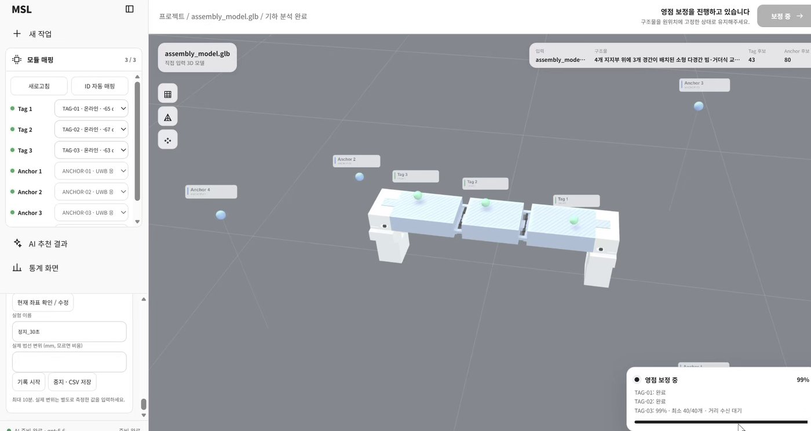 최종 웹 디지털 트윈</td>
<td align="center">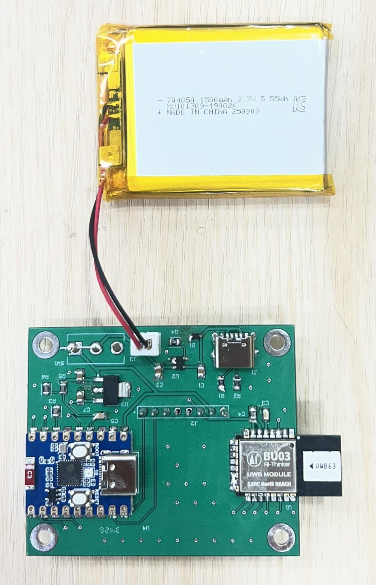 제작한 센서 노드 PCB</td>
</tr>
</table>

---

## 시스템 구성

<ul>
<li>계측 (센서 노드: ESP32-C3 + BU03(DW3000) + ADXL345, Tag 3 · Anchor 4를 공용 PCB 1종으로 제작)
<ul>
<li>변위: Tag와 Anchor가 UWB 신호를 주고받은 왕복 시간(SS-TWR)으로 거리 측정 → 설치 위치와 구조물 표면 방향을 알고 있으므로, 거리 변화에서 표면에 수직한 방향의 변위 하나만 계산</li>
<li>기울기: ADXL345로 중력 방향을 읽어 각도 계산, 설치 시점을 0°로 영점</li>
<li>진동: 10 ms 간격 3축 가속도 벡터 차이가 0.055 g를 넘으면 진동으로 판단</li>
</ul></li>
<li>통신: 센서 ↔ 서버는 Wi-Fi(UDP), 서버 → 웹은 실시간 스트림(SSE). UWB 신호가 겹치지 않도록 서버가 Tag마다 측정 시간을 하나씩 배정(TDMA)</li>
<li>서버 (Node.js): 정지 상태 표본으로 Anchor별 기준 거리 영점 보정 → 상황에 따라 Anchor 2~4개 골라 측정 → 변위 계산 → 다른 Anchor와 어긋나는 값 제거. AI 호출도 서버를 거쳐 API 키 노출 방지</li>
<li>웹 트윈 (Three.js): 구조물 3D 모델(GLB · OBJ) 불러오기 → 표면 후보점 중 AI가 센서 위치 추천 → 실제 센서와 연결 → 영점 보정 → 모니터링. 변위 15 / 30 mm, 기울기 5 / 10°를 넘으면 주의 · 위험 표시</li>
</ul>

<table>
<tr>
<td align="center">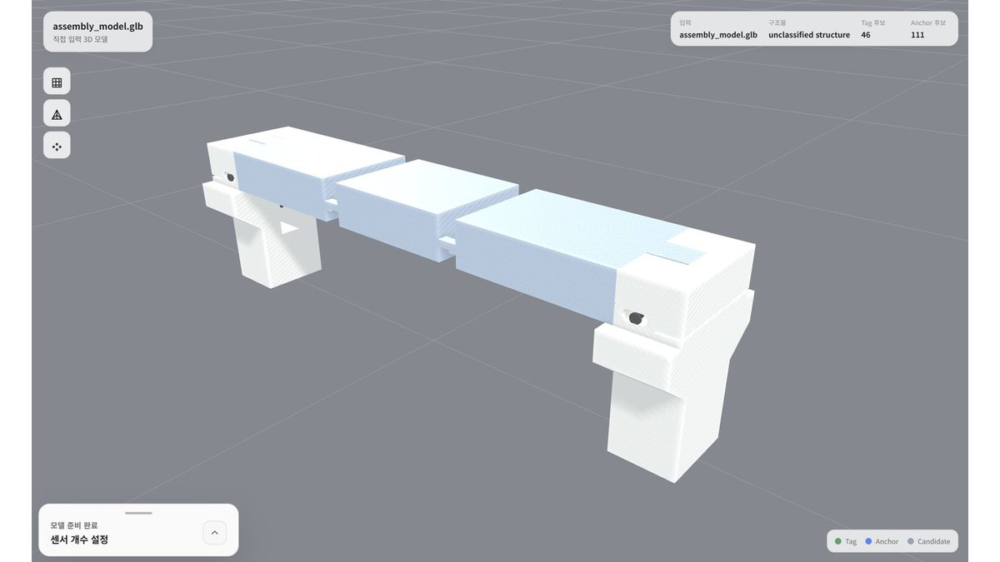 ① 3D 모델 불러오기</td>
<td align="center">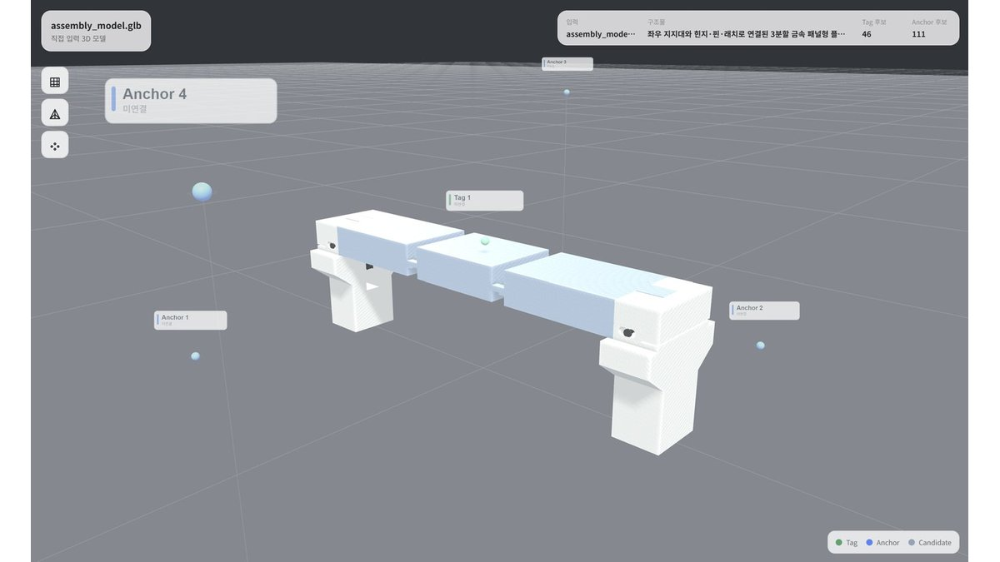 ② AI 센서 배치</td>
<td align="center">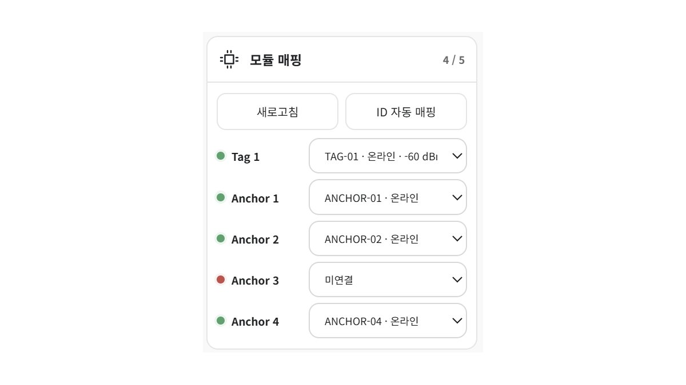 ③ 센서 연결</td>
<td align="center">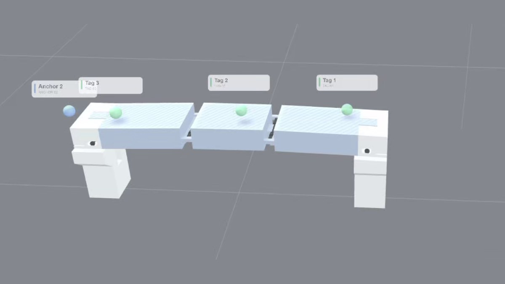 ④ 기울기 모니터링</td>
</tr>
</table>

---

## 담당 역할 및 기여

**3인 팀 프로젝트 | 시스템 설계 · 하드웨어 설계 및 제작**

<table>
<tr><th align="center" width="140">담당 분야</th><th align="left">수행 내용</th></tr>
<tr><td align="center">시스템 구조 설계</td><td align="left">Unity 기반 초기 시스템의 확장성 문제 분석 Node.js 서버와 Three.js 웹 디지털 트윈을 연결하는 전체 시스템 구조 및 센서 데이터 흐름 설계</td></tr>
<tr><td align="center">센서 노드 PCB 공동 설계</td><td align="left">ESP32-C3, BU03(DW3000), ADXL345 기반 공용 PCB 설계 참여 UWB · Wi-Fi 안테나를 보드 양 끝에 배치하고 안테나 아래 RF Keepout 적용 PCB 레이아웃 검토 (DRC 0)</td></tr>
<tr><td align="center">AI 센서 배치 추천 (참여)</td><td align="left">구조물 3D 모델의 표면 후보점을 바탕으로 AI가 구조물별 센서 위치를 추천하는 기능 개발 참여</td></tr>
<tr><td align="center">센서 케이스 설계 · 제작</td><td align="left">PCB와 안테나 위치를 고려한 센서 케이스 3D 모델링 및 3D 프린팅</td></tr>
<tr><td align="center">시연 교량 모형 제작</td><td align="left">변위 · 기울기 · 진동 실험을 위해 상판 3개 구역을 독립적으로 움직일 수 있는 교량 모형 설계 · 제작</td></tr>
</table>

---

## 결과

<table>
<tr><th align="center" width="230">항목</th><th align="center">결과</th><th align="center" width="105">구분</th></tr>
<tr><td align="center">UWB 거리 측정값 표준편차 (30초 정지, 보정 · 필터링 전후)</td><td align="center">28.8 mm → 1.2 mm (보정 전후 95.8% 감소)</td><td align="center">실측</td></tr>
<tr><td align="center">변위 추정 (+50 mm 유지 구간)</td><td align="center">RMSE 2.96 mm (유효 샘플 78개) 같은 회차 복귀 구간 RMSE 8.48 mm</td><td align="center">실측 · 예비 (R14)</td></tr>
<tr><td align="center">AI 센서 배치</td><td align="center">형태가 다른 구조물 4종에서 구조마다 다른 배치 생성 (기능 확인)</td><td align="center">동작 확인</td></tr>
</table>

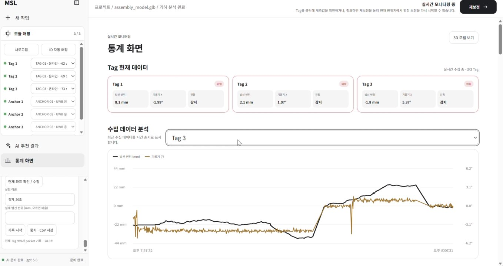 최종 통계 화면

- 거리값 표준편차는 정지 상태 UWB 거리 측정값의 보정 · 필터링 전후 흔들림이고, 변위 정확도(RMSE)와는 별개 지표입니다.
- RMSE 2.96 mm는 최종 시연본(R13.5) 이후 R14 버전 예비 실험 값이며, 측정 보류(HOLD)로 유효 샘플이 제한된 구간입니다. R14 코드와 원시 데이터는 이 저장소에 없습니다.
- 실제 장비에서 모든 조건에 ±5 mm를 안정적으로 달성했다고 입증하지는 못했습니다.

---

## 핵심 문제 해결

②, ③의 서버 알고리즘은 팀원들과 함께 원인을 찾고 고친 내용입니다. 제 담당 범위는 위 담당 역할 표와 같습니다.

### ① 구조물마다 다시 코딩해야 했던 Unity 디지털 트윈의 확장성 문제

<table>
<tr>
<td align="center">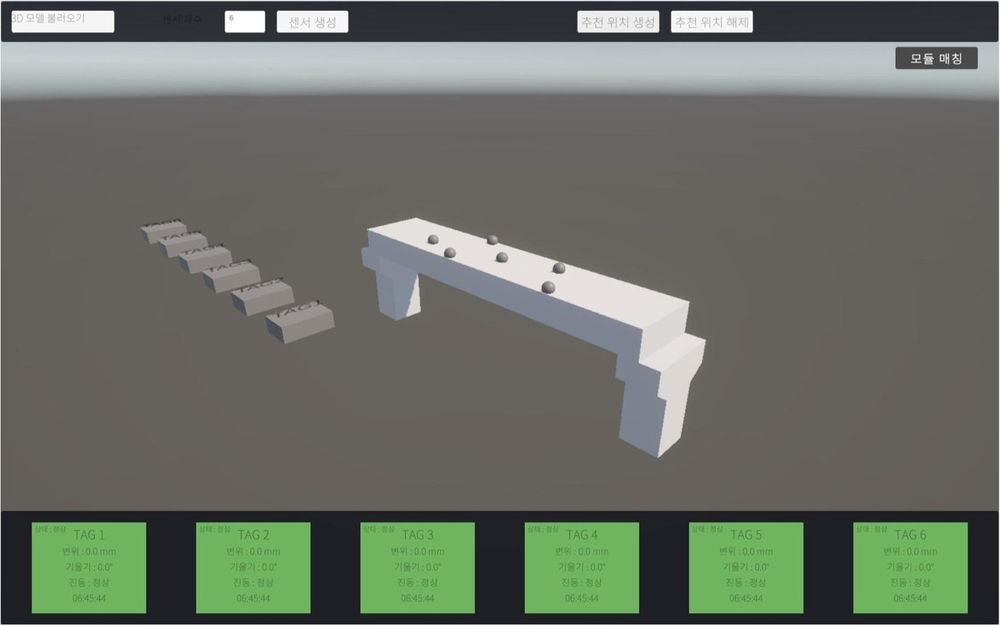 Unity 버전 (임베디드SW경진대회)</td>
<td align="center">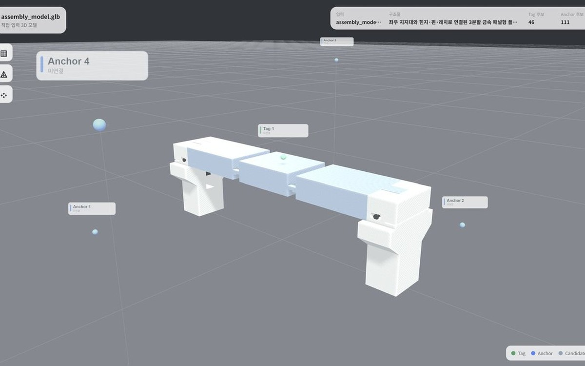 웹 버전 (ECE IF, AI 센서 배치)</td>
</tr>
</table>

<table>
<tr><td align="center" width="70">처음 선택</td><td><ul><li>3D 엔진이라 상판 메시를 직접 움직여 변형을 보여주고, 위험도를 색으로 표시하는 화면을 빠르게 만들 수 있어 Unity로 시작</li><li>구조: ESP32 → UDP → PC 중계 프로그램 → WebSocket → Unity</li></ul></td></tr>
<tr><td align="center" width="70">문제</td><td><ul><li>시연 교량 하나에 맞춰 상판 정점(DeckVertexMask)과 종방향 제어점을 코드에 직접 넣어 변형을 표현 → 다른 구조물을 쓰려면 다시 코딩</li><li>UI를 고칠 때마다 다시 빌드, 센서 데이터를 받으려면 별도 PC 중계 프로그램 필요</li><li>당시 Unity 클라이언트에서 AI API를 직접 호출하려던 구조라, AI 기능을 넣으면 API 키를 실행 파일에 넣어야 했음</li></ul></td></tr>
<tr><td align="center" width="70">해결</td><td>Node.js + Three.js 웹 트윈으로 전환<ul><li>Node.js 서버가 센서 UDP를 직접 받고 브라우저로 실시간 전송(SSE) → PC 중계 프로그램 제거</li><li>구조물을 코드에 넣지 않고 3D 모델 파일(GLB · OBJ)을 불러오는 방식으로 변경</li><li>형상 엔진이 모델 표면에서 센서 후보점(곡률, 표면 방향, 모서리 거리, 높이)을 20 ~ 50개 만들고, AI는 그중 후보 ID만 고르게 해 존재하지 않는 좌표를 만들지 못하게 함</li><li>Tag는 구조적으로 중요한 지점, Anchor는 거리 · 시야 확보 · 배치 기하(GDOP) 조건을 우선</li><li>AI 호출은 서버를 거쳐 API 키를 브라우저에 노출하지 않음</li></ul></td></tr>
<tr><td align="center" width="70">결과</td><td><ul><li>형태가 다른 실제 구조물 4종(광안대교, 남산1호터널, 신시배수갑문, 서울로7017)에 같은 흐름을 적용해 구조물마다 다른 센서 배치가 생성되는 것을 확인 (기능 동작 확인이며, 배치의 공학적 최적성 검증은 아님)</li><li>UI 수정은 새로고침으로 바로 확인</li></ul></td></tr>
</table>

### ② 진동 · 기울기 · 변위 신호 분리와 이상 Anchor 방어

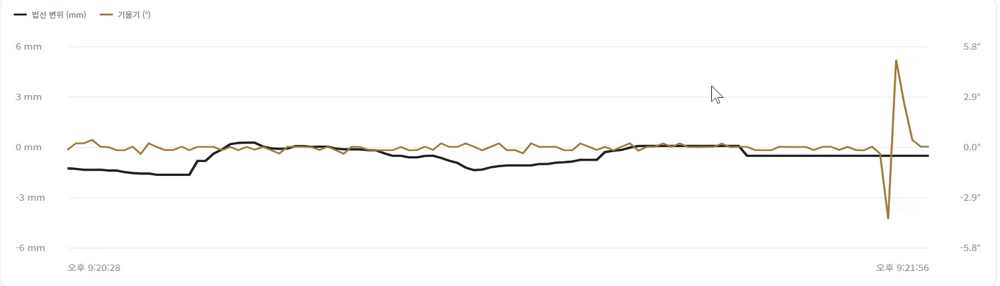 수정 후: 진동(갈색 기울기 값)이 튀어도 변위(검은 선)는 유지

<table>
<tr><td align="center" width="70">문제</td><td>하나의 ADXL345와 UWB 값으로 세 가지를 판단하다 보니 서로 잘못 인식<ul><li>진동 → 기울기: 흔들리는 진동이 진동으로 안 잡히고 기울기 값만 출렁임</li><li>진동 → 변위: 모형 위를 걸었을 뿐인데 Tag 1에 이어 움직이지 않은 Tag 2 · 3의 변위까지 틀어짐 (실측, 9월 16일)</li><li>진동 중 실제 변위 차단: 진동과 함께 실제로 약 60 mm 움직였는데, Anchor 하나가 크게 틀리자 합의가 안 돼 계속 이전 위치에 고정 (실측, R13.4 · <a href="web/notes/R13_5_CHANGES.md">기록</a>)</li></ul></td></tr>
<tr><td align="center" width="70">원인</td><td><ul><li>진동 판정을 가속도 크기 변화(|Δ|a|| > 0.08 g)로 했는데, 좌우로 흔들리는 진동은 크기는 1 g 그대로이고 방향만 바뀌어 놓침</li><li>진동 신호를 "변위가 생기는 중"이라는 증거로 써서 추정기의 이동 허용 범위를 넓힘 → 진동으로 튄 UWB 거리가 변위로 반영</li><li>이를 막으려고 진동 중엔 모든 Anchor가 동의해야 변위를 인정하게 했더니, Anchor 하나만 틀려도 실제 변위까지 거부</li></ul></td></tr>
<tr><td align="center" width="70">해결</td><td>신호마다 판단 기준을 분리<ul><li>진동 판정: 크기 변화 → 10 ms 간격 3축 가속도 벡터 차이 √(Δax² + Δay² + Δaz²) > 0.055 g로 변경. 방향만 바뀌는 진동도 잡힘</li><li>기울기 ↔ 진동 분리: 기울기는 중력 방향 atan2(ax, az)로 계산. 중력만 고려하면 0.055 g는 10 ms 안에 약 3° 방향이 바뀌어야 넘는 값이라, 느린 기울기 변화는 진동으로 잡히기 어렵게 함 (근사 기준)</li><li>진동 → 변위 차단: 진동 중에는 Anchor별 변위 후보(잔차 변화 ÷ 변위 민감도) 중 3개 이상이 퍼짐 10 mm(25 mm 이상 큰 변위는 18 mm) 안에서 같은 값을 가리키고, 0.85초 안에 2번 연속 나올 때만 변위 갱신. 아니면 <code>verification_only</code> 상태로 이동 제한</li><li>진동 중 실제 변위 차단 해결: 모든 Anchor 합의 대신 맞는 Anchor끼리의 묶음만 보고 판단. 크게 어긋나는 Anchor는 그 측정에서 제외하고 반복되면 2.2초 격리. 좋은 Anchor 3개 이상이 25 ~ 90 mm 변위에 계속 동의하면 이전 값을 지우고 새 위치로 다시 잡음(재획득)</li></ul></td></tr>
<tr><td align="center" width="70">결과</td><td><ul><li>진동 중 +20 mm 이동 입력 → 19.99 mm (합성)</li><li>Anchor 하나에 +600 mm 오류를 넣은 상태에서 +60 mm 이동 입력 → 61.6 mm로 재획득, 틀린 Anchor 자동 격리 (합성)</li><li>+60 → +20 → −35 → +45 → 0 mm 연속 이동을 32개 시드로 반복, 안정 후 오차 최대 0.78 mm (합성)</li><li>실제 모형에서 같은 조건을 정량 반복 측정한 결과는 아직 없음</li><li>실측에서는 R13.5에서도 +70 mm 이동이 약 0 mm로 차단됨. 같은 시점에 Anchor 3개가 일치해야 하는 엄격한 재획득 조건이 원인이었으며, 이후 버전에서는 시간에 걸친 측정 증거를 허용하도록 변경. 추가로 실제 약 2 Hz 수신 속도와 맞지 않는 표본 요구 조건(1.2초 안에 Anchor별 4개)도 수정 (<a href="docs/DEVELOPMENT_LOG.md">개발 기록</a>)</li></ul></td></tr>
</table>

### ③ UWB 측정 안정도와 실측 정확도

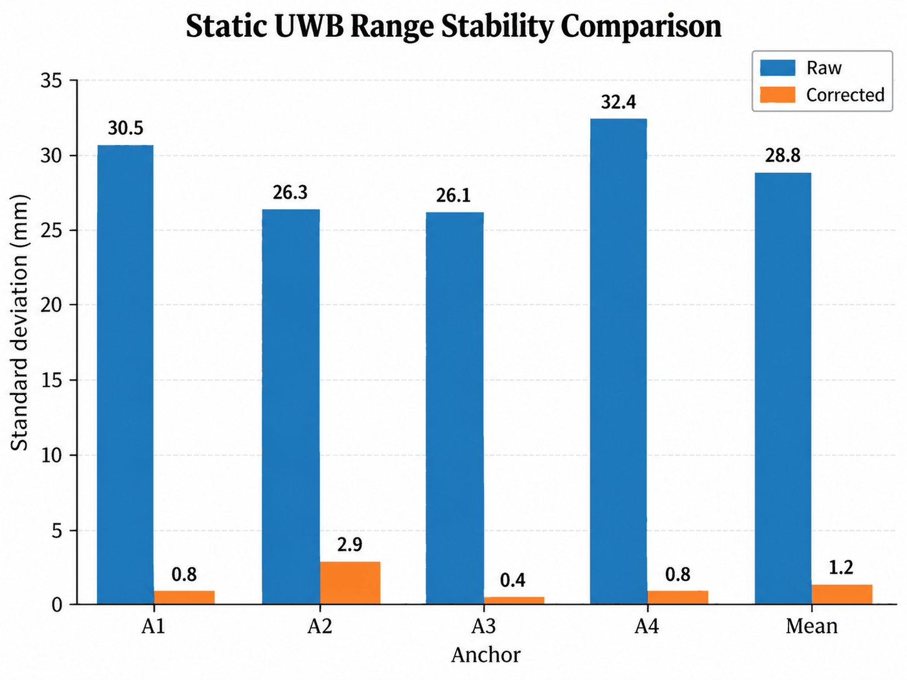 보정 전후 Anchor별 UWB 거리 흔들림 (30초 정지 측정)

<table>
<tr><td align="center" width="70">문제</td><td><ul><li>Tag를 움직이지 않았는데 변위가 +12.6 mm로 표시되고, 정지 상태 출력이 ±12 mm 흔들림 (실측, 목표 ±5 mm)</li><li>Anchor 4개 모두 정상 응답, 기울기 · 진동도 없는 상태 → 통신은 성공해도 거리가 정확하지 않음</li></ul></td></tr>
<tr><td align="center" width="70">원인</td><td><ul><li>UWB 거리값 자체의 랜덤 잡음, 주변 반사(다중경로), 장애물 가림(NLOS), Anchor마다 다른 고정 편향</li><li>Tag 3개가 동시에 측정하면 UWB 신호끼리 충돌</li></ul></td></tr>
<tr><td align="center" width="70">해결</td><td>필터와 통신 측면을 함께 수정<ul><li>필터: 기준 거리를 정지 표본 180개(최소 15초)에서 상 · 하위 20%를 버린 평균으로 잡아 고정 편향 제거, 4초 슬라이딩 윈도(움직임 감지 시 자동 단축)와 MAD로 순간 튀는 값 제거</li><li>Tag 번갈아 측정(TDMA): 서버가 한 번에 Tag 하나에만 측정 시간을 배정(최대 320 ms), 시간이 끝나면 Tag가 스스로 UWB를 멈춰 신호 충돌 방지</li><li>신뢰도 가중치: Anchor마다 가중치 = 수신 성공률 × min(1, (12 mm / 잡음)²) × NLOS 계수. NLOS 계수는 DW3000 수신 파형(CIR)으로 구한 NLOS 점수로 (1 − 0.8 × 점수, 최소 0.18)이고 NLOS 의심 판정이면 × 0.55. 거리값 자체는 고치지 않고 가중치만 낮춤</li><li>Anchor 수 조절: 평소엔 변위 방향 민감도 · 성공률 · 잡음 · NLOS 점수가 좋은 Anchor 2개만 측정, 진동 · 갑작스러운 60 mm 이상 거리 변화 · NLOS 의심 시 3 ~ 4개로 확장, 2.8초마다 4개 전체 점검</li></ul></td></tr>
<tr><td align="center" width="70">결과</td><td><ul><li>정지 상태 UWB 거리 측정값의 보정 · 필터링 전후 표준편차 평균 28.8 → 1.2 mm, 95.8% 감소 (실측, 30초 정지 측정, 거리 안정도 지표)</li><li>+50 mm 유지 구간 변위 RMSE 2.96 mm, 유효 샘플 78개 (실측 · R14 예비 실험)</li></ul></td></tr>
<tr><td align="center" width="70">한계</td><td><ul><li>같은 회차 복귀 구간 RMSE 8.48 mm, 측정 보류(HOLD)가 많아 유효 샘플이 적음 (실측)</li><li>강한 진동과 여러 결함을 겹친 정지 시험에서 순간 가짜 변위 최대 17.7 mm (합성)</li><li>프로젝트에서 설정한 정지 오차 목표 ±5 mm를 모든 조건에서 만족하지 못함</li></ul></td></tr>
</table>

---

## 미해결 문제

### 붐비는 대회장에서 커진 UWB 오차와 빨라진 배터리 소모

<table>
<tr><td align="center" width="70">관측</td><td><ul><li>실험실에서는 안정적이던 UWB 측정이 사람과 전자기기로 붐비는 대회장에서 오차가 커지고 Anchor 연결이 불안정해짐</li><li>같은 시연 시간인데 센서 노드 배터리가 실험실보다 빨리 닳음</li></ul></td></tr>
<tr><td align="center" width="70">원인 가설</td><td><ul><li>UWB: 사람에 의한 가림(NLOS), 주변 전파 환경, DW3000 수신 상태 고착, 전원 불안정 중 확정되지 않음</li><li>배터리: 측정 전이라 원인 미확정 (재측정 · 재연결 반복으로 인한 소비 증가 가능성)</li></ul></td></tr>
<tr><td align="center" width="70">현장 대응</td><td><ul><li>Tag의 기울기 · 진동 값은 계속 들어와서 Wi-Fi · PC보다 UWB 경로 쪽으로 범위를 좁힘</li><li>위 가설을 전원 / SPI / DW3000 상태 / 안테나 · 가림 / 주변 전파 환경으로 나눠 점검</li><li>시연본 Anchor 펌웨어에 수신 대기가 900 ms 멈춰 있으면 다시 수신을 시작하는 감시(RX watchdog) 추가</li><li>이후 버전(R14)에서 응답 실패 · 장시간 무응답 감지 → DW3000 재초기화 → ESP32 재시작으로 이어지는 자가 복구로 확장 (R14 코드는 이 저장소에 없음)</li></ul></td></tr>
<tr><td align="center" width="70">계획</td><td><ul><li>ESP32-C3 · DW3000 · ADXL345 등 부품별 소비 전력을 측정해 배터리 소모 원인 확인</li><li>실험실과 붐비는 환경에서 같은 배치로 NLOS 점수 · 성공률 · 거리 분산을 기록해 UWB 오차 원인 가설 검증</li><li>측정 결과를 바탕으로 PCB 전원선(폭 · 경로 · 디커플링)을 수정</li></ul></td></tr>
</table>

---

## 배운 점

- 무엇을 잴지부터 정했다. Tag의 3D 위치 대신 "설치면에 수직한 변위 하나"를 구하도록 바꾸자 미지수가 3개에서 1개로 줄어 Anchor 2개로도 계산할 수 있었고, 이후 측정 구조가 이 정의를 따라 정해졌다.
- PCB를 그릴 때 안테나 배치 · Keepout과 케이스 안 안테나 위치를 같이 봐야 했다. 센서 좌표를 케이스 중심으로 잡았다가, 거리 측정 기준인 안테나 중심과 긴 축으로 32.5 mm 차이가 나는 걸 뒤늦게 확인했다.
- 통신이 성공해도 거리값이 틀릴 수 있었다. 팀에서 TDMA, Anchor 수 조절, CIR 기반 NLOS 가중치를 적용하면서 응답 여부보다 측정 품질(성공률 · 잡음 · NLOS 점수)을 기록하고 비교하게 됐다.
- 합성 시험을 통과한 알고리즘이 교량 모형에서는 실패했다(R13.5 재획득). 이후에는 통신 → 거리 측정 → 기하 후보 → 추정기 승인 → 화면 단계별로 기록을 남겨 어디서 끊기는지 확인했다.
- UWB 모듈(BU03 · DW3000), ESP32-C3, ADXL345, Altium, Inventor 모두 처음 쓰는 상태에서 하나씩 조사해 골랐다.

### 이후 연구

필터와 통신 방식만으로는 정지 오차 목표(±5 mm)를 모든 조건에서 만족하지 못했다. 지금은 개인 프로젝트로 DW3000의 CIR 파형을 입력으로 딥러닝 모델이 거리 오차 자체를 보정하는 방법을 연구하고 있다. 이 시스템에서 CIR은 NLOS 의심 점수를 계산해 Anchor 가중치를 낮추는 데만 썼고, 거리값은 고치지 않았다.

---

단계별 시행착오 전체 기록과 실행 방법: [docs/DEVELOPMENT_LOG.md](docs/DEVELOPMENT_LOG.md)
