# 개발 기록

3인 팀 프로젝트 기록이다. 3 \~ 7장의 서버 알고리즘 문제는 팀원들과 같이 원인을 찾고 고친 내용이고, 내가 맡은 건 시스템 구조 설계, 센서 노드 PCB 공동 설계, 케이스, 교량 모형, AI 센서 배치 기능 개발 참여다.

## 0. 처음 구조 잡기

- 처음엔 UWB로 Tag의 3D 위치(x, y, z)를 매번 새로 구하려고 했다.
- 근데 생각해보니 알고 싶은 건 "Tag가 어디 있냐"가 아니라 "설치한 자리에서 얼마나 움직였냐"였다. 설치 좌표랑 구조물 모양은 이미 알고 있었다.
- 그래서 구조물 표면에 수직한 방향으로 움직인 거리 d 하나만 구하는 걸로 바꿨다.
  r_i(d) = ‖p₀ + d·n − a_i‖ (p₀: 설치 위치, n: 표면 방향, a_i: Anchor 위치)
- ADXL345로 가속도 두 번 적분해서 위치 구하는 것도 생각했는데 오차가 계속 쌓여서 포기했다. 기울기랑 진동 감지에만 쓰기로 했다.
- 처음엔 Anchor 4 + Tag 4였는데 모형 실험하면서 Anchor 4 + Tag 3으로 줄였다.

---

## 1. Unity로 시작 → 웹으로 갈아탔다

| Unity 버전 | Unity 버전 위험 표시 |
|:---:|:---:|
| 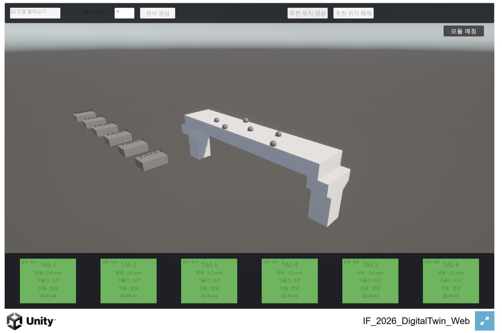 | 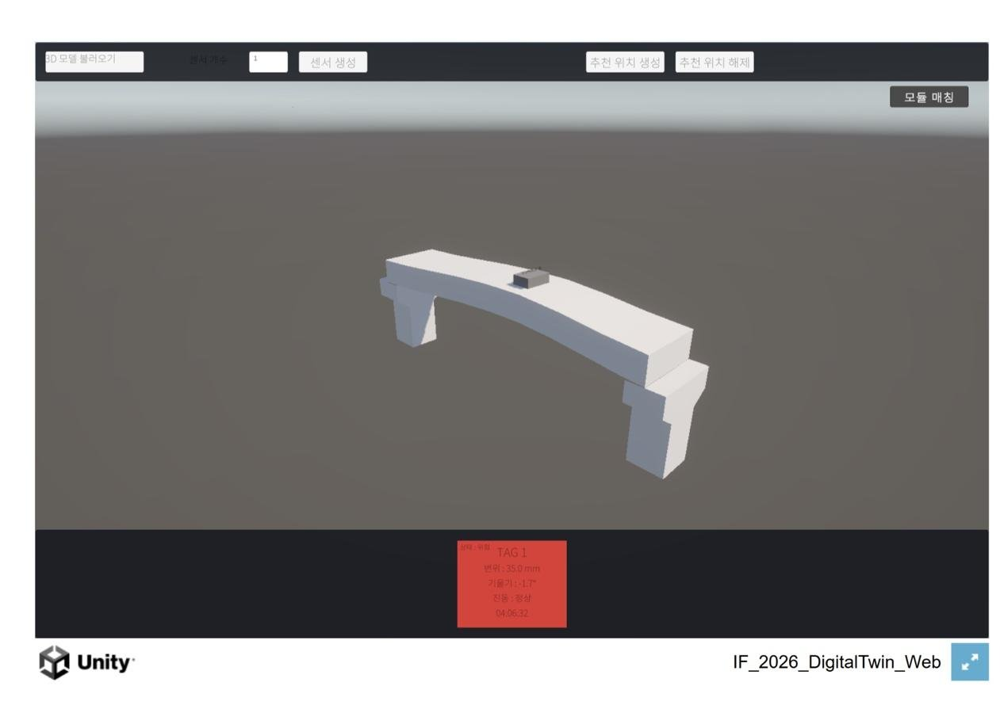 |

- 처음엔 Unity로 만들었다. 3D 엔진이라 상판 메시 움직여서 휘는 거 보여주고, 위험하면 색 바꾸는 게 금방 됐다. 임베디드SW경진대회는 이 버전으로 제출했다.
- 구조: ESP32 → UDP → PC 중계 프로그램 → WebSocket → Unity
- 근데 쓰다 보니 문제가 계속 나왔다.
  - 상판 정점(DeckVertexMask)이랑 제어점을 시연 교량 하나에 맞춰서 코드에 박아놨다 → 다른 구조물 쓰려면 처음부터 다시 짜야 했다
  - UI 하나 고칠 때마다 다시 빌드해야 했다
  - 센서 받으려면 중계 프로그램을 따로 켜야 했다
  - AI로 센서 위치 추천 넣고 싶었는데, Unity 앱에서 AI API를 바로 부르는 구조라 그러면 API 키를 실행 파일에 넣어야 했다
- 결국 Unity는 버리고 웹(Node.js + Three.js)으로 옮겼다.
  - 바로 넘어가진 않고 Vite + React + Three.js로 "모델 올리기 → 후보점 만들기 → Tag/Anchor 표시 → 실제 센서 연결 → 기준 잡기 → 모니터링" 흐름을 가짜 데이터로 먼저 돌려봤다
  - 서버가 UDP 직접 받고 브라우저로 SSE로 쏴주게 해서 중계 프로그램이 없어졌다
  - 3D 모델은 스마트폰 스캔(Polycam, RealityScan, KIRI) 써봤고, 파일은 GLB 위주로 GLTF, OBJ도 비교했다
- AI 배치 처음 버전은 AI한테 좌표를 그냥 달라고 했는데, 표면에 없는 좌표를 지어냈다.
  → 형상 엔진이 표면 위 후보점(곡률, 표면 방향, 모서리 거리, 높이 등)을 먼저 만들고 20\~50개로 줄인 다음, AI는 후보 ID만 고르게 바꿨다.
  → Tag는 구조적으로 중요한 위치를 AI가 고르고, Anchor는 거리, 시야, GDOP 같은 기하 조건을 먼저 보게 했다
- 광안대교, 남산1호터널, 신시배수갑문, 서울로7017에 똑같이 돌려봤더니 구조물마다 배치가 다르게 나왔다.

| 광안대교 | 남산1호터널 |
|:---:|:---:|
| 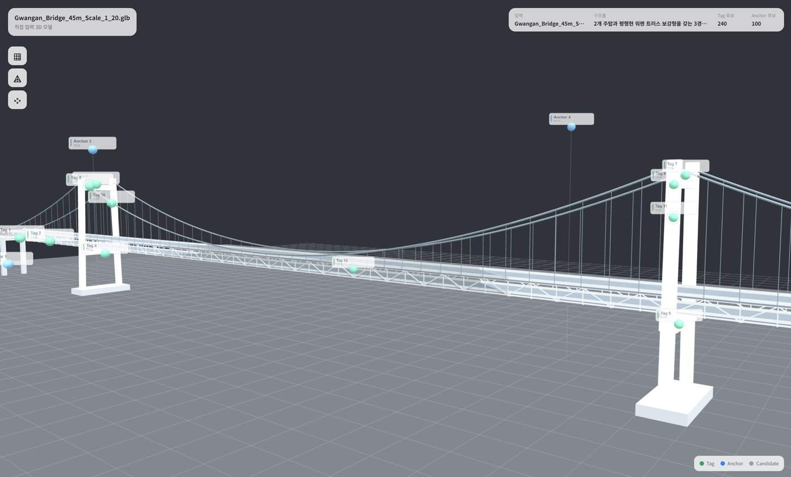 | 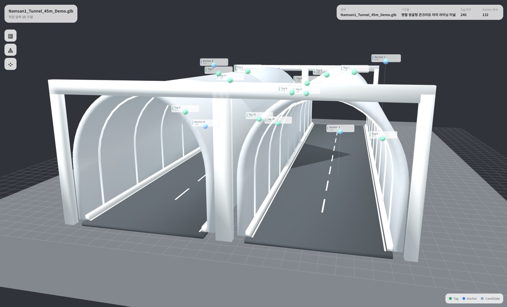 |
| 신시배수갑문 | 서울로7017 |
| 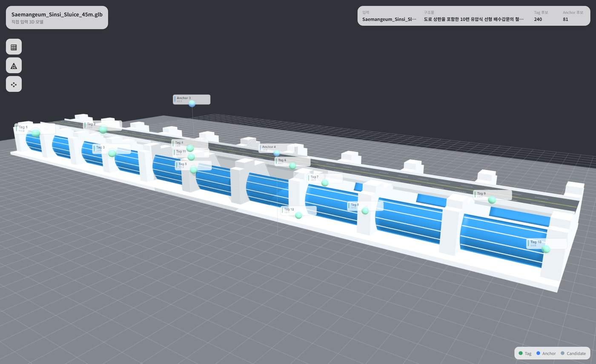 | 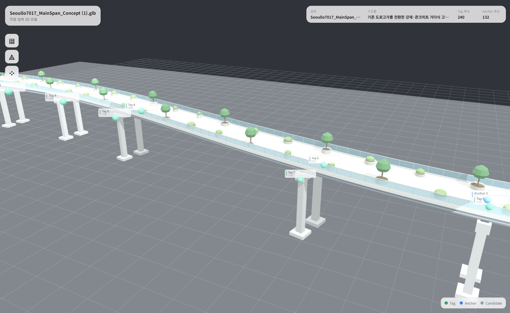 |

---

## 2. 하드웨어 (PCB, 케이스, 교량 모형)

| PCB 구성 | 실제 보드 |
|:---:|:---:|
| 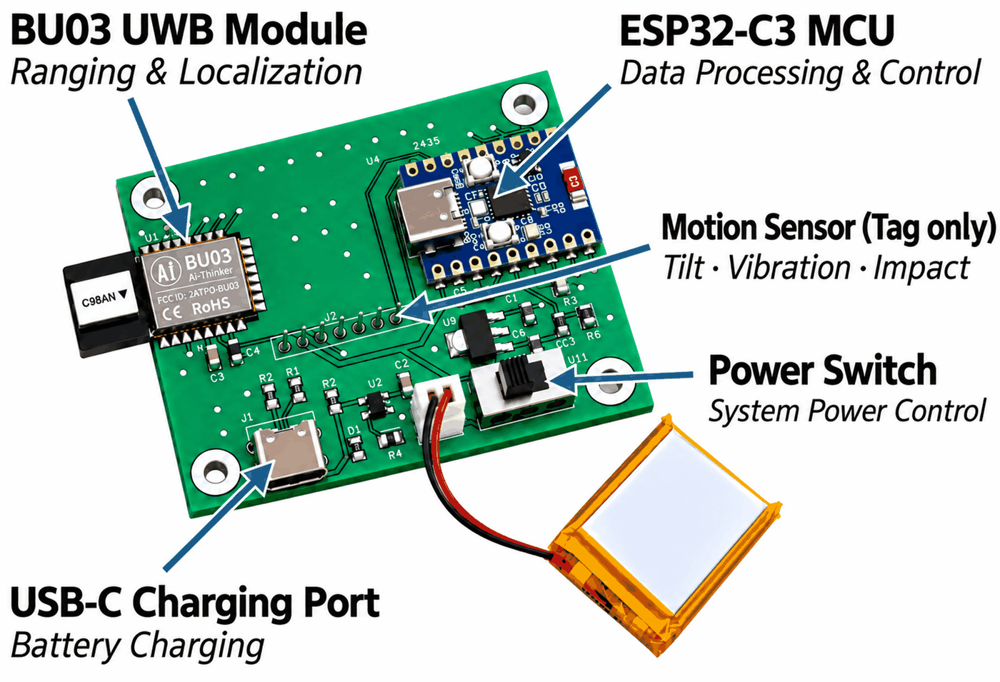 | 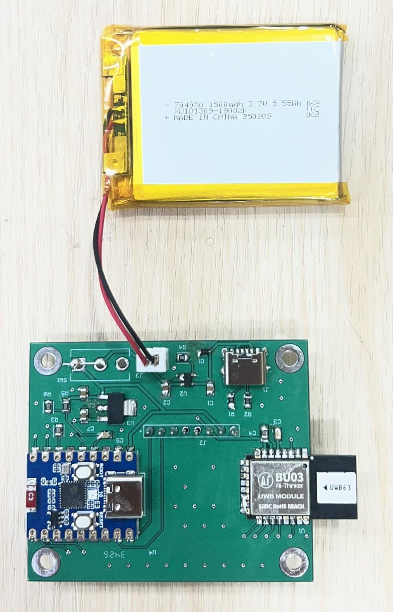 |

- Tag랑 Anchor 보드를 따로 만들면 일이 두 배라서 PCB 하나로 통일했다. ADXL345 달았는지랑 펌웨어로만 Tag/Anchor를 나눴다.
- 구성: ESP32-C3-Zero + BU03(DW3000) + ADXL345 + 1셀 Li-Po, 충전 IC MCP73831, 3.3 V LDO MCP1825, USB-C 충전, 전원 스위치. 약 60 × 50 mm 2층.
- BU03, ESP32-C3-Zero는 Altium 라이브러리가 없어서 풋프린트 직접 그리고 실제 모듈이랑 치수를 맞춰봤다.
- UWB 안테나랑 Wi-Fi 안테나가 서로 간섭할까 봐 보드 반대쪽 끝으로 떨어뜨리고, ESP32 세라믹 안테나 밑은 동박을 비웠다.
- DRC 오류 처음엔 잔뜩 떴는데 전기 오류 / 제조 규칙 / 실크 겹침으로 나눠서 하나씩 잡았다 → DRC 0, 거버까지 뽑았다.

| PCB 레이아웃 | 노드 구성 | 뒷면 (ADXL345) |
|:---:|:---:|:---:|
| 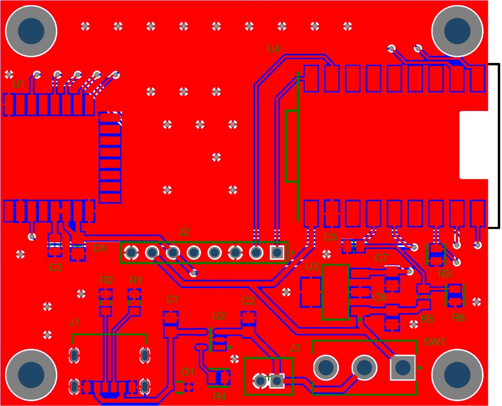 | 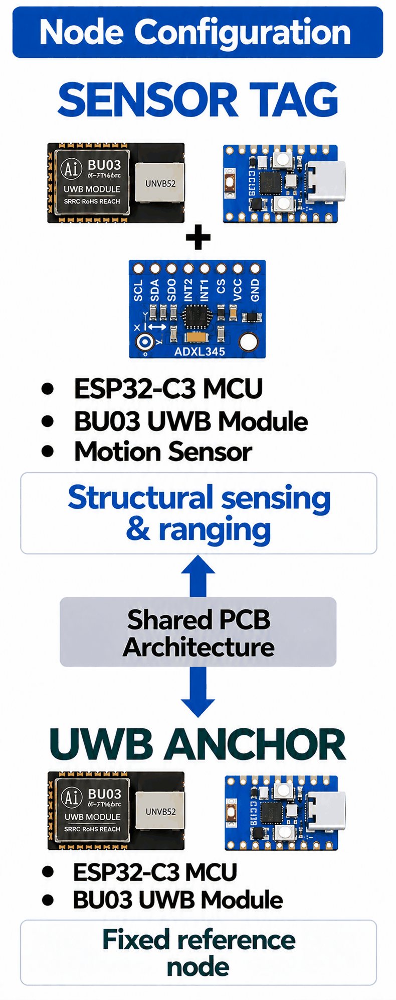 | 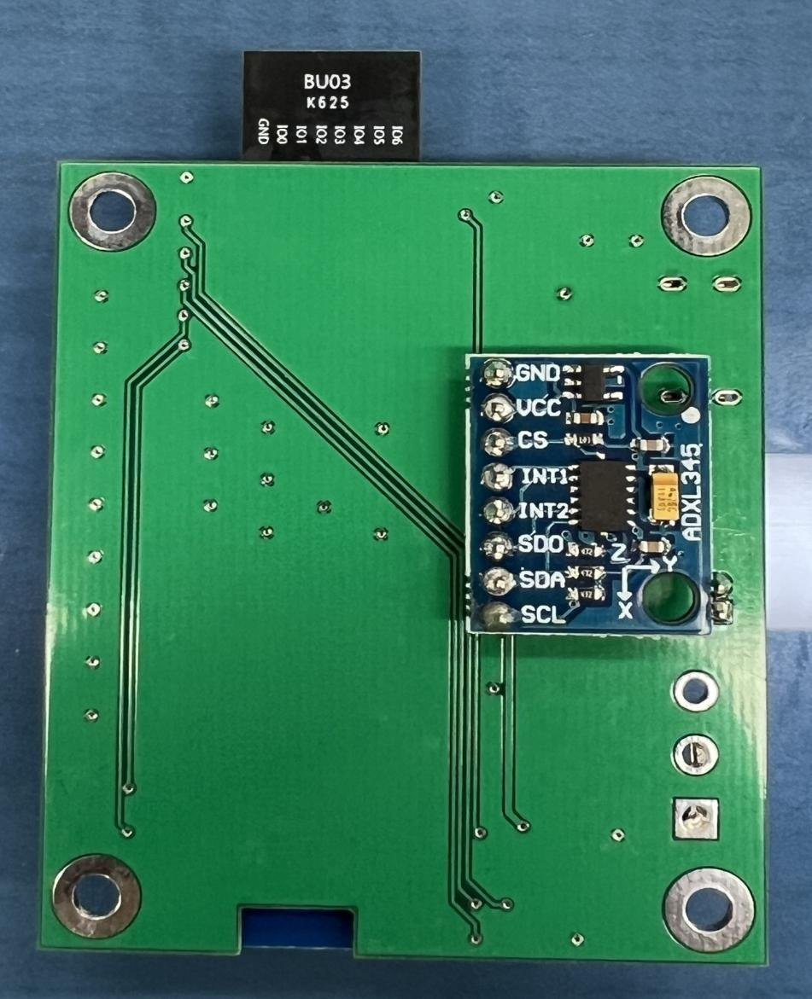 |

- 케이스는 3D 프린팅했다. UWB · ESP 쪽 구멍, 스위치, USB-C, PCB 고정 기둥 4개, 배터리 칸을 맞춰서 설계했다.

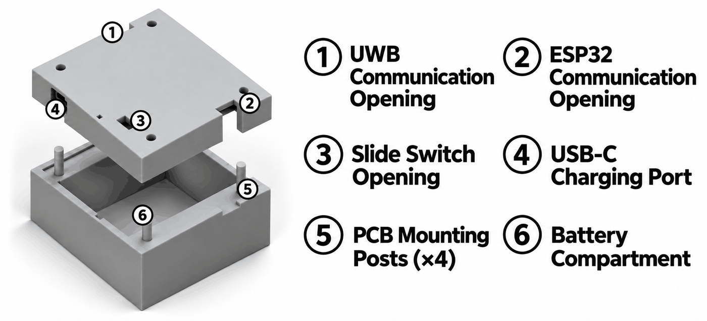

- 교량 모형은 상판을 세 칸으로 나눠서 위아래로 움직이거나 기울일 수 있게 만들었다. 변위, 기울기, 진동을 손으로 재현하기 위해서다.

| 측면 | 위 |
|:---:|:---:|
| 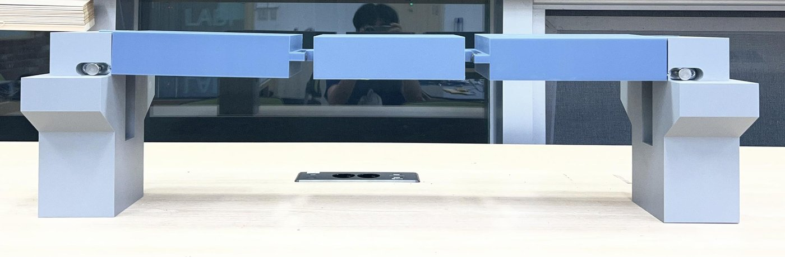 | 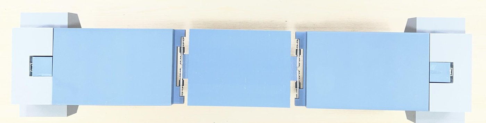 |

---

## 3. 가만히 있는데 변위가 떴다 (R6 → R8)

- 9월 12일쯤 실험이었다. Tag 안 건드렸는데 +12.6 mm가 떴다. 정지 상태에서 ±12 mm 정도 왔다 갔다 했다 (목표 ±5 mm).
- Anchor 4개 다 응답이 들어왔고, 기울기 0.13°, 진동도 없었다. 통신은 멀쩡한데 거리가 틀린 거였다.
- 원인 후보로 생각한 것: UWB 자체 잡음, 반사(다중경로), Anchor마다 다른 고정 편향, 기하 때문에 오차가 커지는 것, 보정 표본 부족.
- 해본 것 (R7)

| | R6 | R7 |
|:---:|:---:|:---:|
| 보정 표본 / 시간 | 80개 / 7초 | 200개 / 20초 |
| 보정 대표값 | 중앙값 | 상·하위 20% 버린 평균 |
| 실시간 필터 | 최근 7개 평균 | 약 1.8초 창 |
| Anchor 가중치 | 거의 똑같이 | 잡음 분산 역수 × 수신 성공률 |
| 잡음 추정 | 처음 보정 때만 | 실시간 MAD 추가 |
| 통신 끊겼다 돌아올 때 | 필터 초기화 (값 튐) | 마지막 정상 값 유지 |

- 결과 (합성): 정지 RMSE 4.64 → 2.86 mm, Anchor 하나 잡음 크게 넣은 경우 5.55 → 2.08 mm
- 따로 30초 정지 실험에서 Anchor별 거리 흔들림(표준편차)은 평균 28.8 → 1.2 mm까지 줄었다.

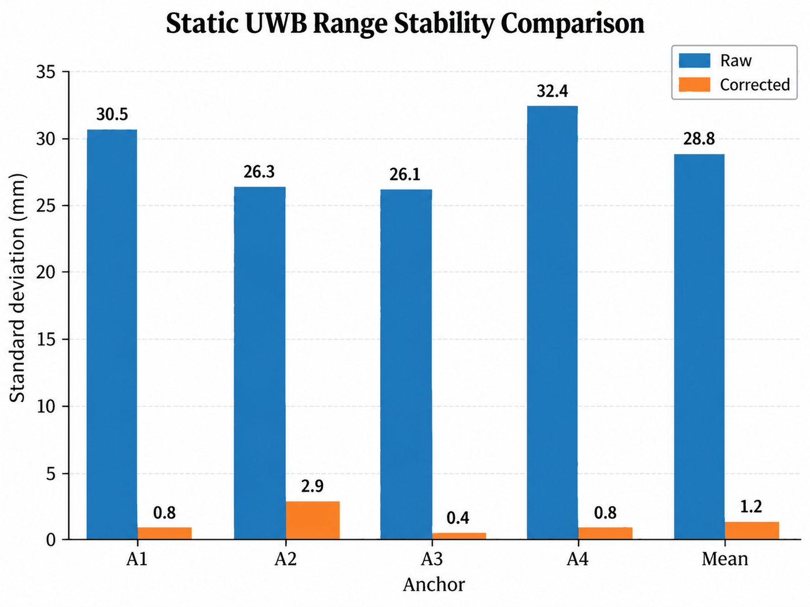

- 근데 필터를 길게 하니까 이번엔 느려졌다. 30 mm 움직였을 때 90%까지 따라가는 데 5.3초가 걸렸다.
  → R8에서 빠르게 따라가는 경로를 하나 더 둬서 약 0.9초로 줄였다 (합성).

---

## 4. 측정이 느리고 보정이 안 끝났다 → Dual-Pair → Adaptive (R11 → R12)

- 보정이 99%에서 안 넘어갔다. 응답은 4/4 들어오는데도.
  로그 까보니 Anchor 1 잡음이 94.2 mm (허용 50 mm), 21.7초 동안 거리가 0.729\~1.224 m를 왔다 갔다 했다. 표본이 모자란 게 아니라 표본 질이 나빴던 것이다.
- 그리고 Tag 3개 × Anchor 4개면 한 바퀴에 12번 재야 한다. Anchor 하나가 응답 안 하면 다른 Tag 갱신까지 다 밀렸다. 로그에 `uwb_slot active=false`가 계속 찍히고 특정 Tag만 갱신 안 되는 것도 봤다.
- 해본 것 1: Dual-Pair (R11.5.8)
  높이 다른 두 그룹에서 하나씩, `{A2, A4} → {A1, A3}` 이렇게 2개만 번갈아 쟀다. 실패하면 같은 그룹 다른 Anchor로 대체했다. Tag당 측정이 4회 → 2회로 줄었다.
  → 근데 조합이 바뀔 때마다 가만히 있어도 약 −60 mm가 튀었다. Anchor마다 남은 편향이 다른데 2개뿐이라 서로 검증할 여유가 없었다.
- 해본 것 2: 절대 거리 대신 보정 시점 대비 거리 변화량 Δr_i를 쓰고, 기하 모델로 계산한 예상 변화량이랑 비교했다. 모든 조합이 보정 시점에 0 mm가 되게 맞췄다.
- 해본 것 3: Adaptive 2 → 3 → 4 (R12)
  평소엔 2개만, 잔차나 진동, NLOS, 통신 실패가 커지면 3개, 4개로 늘렸다가 괜찮아지면 다시 줄였다. 2.6초마다 한 번씩 4개 다 재서 안 쓰던 Anchor 상태도 확인했다.

| 판단 항목 | 3개로 | 4개로 |
|:---:|:---:|:---:|
| 동적 가속도 | 0.025 g | 0.055 g |
| 거리 잔차 | 22 mm | 40 mm |
| 변위 불확도 | 30 mm | 55 mm |
| NLOS 점수 | 0.45 | 0.72 |

- 하다가 이상한 걸 발견했다. 서버는 Dual-Pair로 오길 기다리는데 Tag 펌웨어는 아직 4개 다 재고 있었다. 버전이 서로 안 맞았던 것이다. `slot_protocol: 3`으로 맞췄다.
- DW3000 수신 파형(CIR)으로 NLOS 의심 점수를 매기기 시작했다. 거리는 안 건드리고 가중치만 낮추는 용도로만 썼다.

---

## 5. 좋은 Anchor 고르기, 그리고 Runaway (R13.1 → R13.2)

- 가까운 Anchor가 좋은 Anchor가 아니었다. 변위 방향으로 거리가 잘 변하고(H_i) 잡음이 작은(σ_i) Anchor가 좋은 거라 I_i = H_i² / σ_i²로 골랐다.
- 사람이 Stable / Precision / Responsive 모드 고르던 것도 없애고 [변위, 속도] 하나로 알아서 대응하는 추정기로 합쳤다.
  → 근데 합성 정지 RMSE가 5.87 mm로 목표보다 컸다.
- 실험 영상 보다가 가만히 있는 Tag 변위가 수십\~수백 mm까지 커지는 걸 봤다 (Runaway).
- 코드를 따라가 보니
  - 가우스-뉴턴 이동 제한이 업데이트 한 번이 아니라 반복 계산마다 걸려 있었다 → 63 mm × 8회 = 한 번에 504 mm까지 갈 수 있는 구조였다
  - 잔차 큼 → 움직임 점수 올라감 → 더 많이 움직이게 허용 → 잔차 더 커짐. 스스로 키우는 루프였다
  - 출력에서 걸러도 내부 상태는 이미 오염돼 있었다
- 고친 것: 이동 제한을 업데이트 단위로 바꾸고, 잔차가 움직임 점수에 주는 영향을 0.45 → 0.12로 낮추고, 거부된 값은 내부 상태에도 안 넣게 했다. 예측 변위 ±160 mm 보호도 추가했다.

---

## 6. 진동 때문에 다 틀어졌다 → 너무 막아서 진짜 변위도 막혔다 (R13.3 → R13.5)

- 9월 16일 실험이었다. 모형 옆에서 걷기만 했는데 Tag 1이 틀어지고, 이어서 안 움직인 Tag 2, 3도 같이 틀어졌다.
- 그때까지는 "진동 = 뭔가 움직이는 중"이라고 보고 추정기를 더 자유롭게 풀어줬다. 진동 오면 UWB 거리도 같이 흔들리니까 그게 그대로 변위로 들어간 것이다. 같은 진동을 Tag 3개가 다 받으니까 다 같이 틀어졌다.
- 생각을 뒤집었다. 진동 = 움직였다는 증거가 아니라 "UWB를 더 꼼꼼히 확인해야 하는 상황" (R13.4)
  - Anchor마다 평소 잔차를 기준선으로 학습해두고, 기준선 대비 변화로 Anchor별 변위 후보를 계산했다
  - 진동 중엔 후보 3개 이상이 퍼짐 10 mm 안에서 같은 값을 가리키고, 0.85초 안에 2번 연속 나와야 변위를 갱신하게 했다
  - 합의 안 되면 `verification_only` 상태로 두고 거의 안 움직이게 묶었다
  - Tag 펌웨어도 진동 오면 무조건 4개 재던 걸 최소 3개로 바꿨다
  - ADXL345는 변위를 만드는 게 아니라 UWB 검증을 켜는 스위치로만 썼다
- 결과 (합성): Anchor 하나 +250 mm 튀어도 가짜 변위 최대 0.95 mm, 진동 중 +20 mm 이동을 넣으면 19.99 mm. 근데 강한 공통 진동에선 7.11 mm까지 나왔다.
- 진동 감지 방식도 바꿨다. 원래는 가속도 크기 변화(|Δ|a|| > 0.08 g)로 봤는데, 좌우로 흔들리는 진동은 크기는 1 g 그대로라 못 잡고 기울기 값만 출렁였다.
  → 10 ms 간격 3축 벡터 차이 √(Δax² + Δay² + Δaz²) > 0.055 g로 바꿨다. 0.055 g면 10 ms 안에 3° 정도 기울어야 넘는 값이라 실제 구조물의 느린 기울기는 진동으로 안 잡힌다.
- 그런데 이번엔 반대로 너무 막았다. 진동이랑 같이 실제로 약 60 mm 움직였는데 Anchor 하나가 이상하니까 합의가 안 돼서 계속 예전 위치에 고정됐다 (R13.4, 실측).
- 다시 고쳤다 (R13.5)
  - 모든 Anchor 합의 대신, 서로 맞는 Anchor끼리 묶음만 보고 판단하게 했다
  - 크게 어긋나는 Anchor는 그 측정에서 빼고, 계속 그러면 2.2초 격리했다
  - 좋은 Anchor 3개 이상이 25\~90 mm 변위에 계속 동의하면 예전 값 지우고 새 위치로 다시 잡게 했다(재획득)
- 결과 (합성): Anchor 하나에 +600 mm 오차를 넣고 +60 mm 이동을 입력했을 때 → 61.6 mm, 망가진 Anchor는 자동 격리됐다. +60 → +20 → −35 → +45 → 0 mm 연속 이동 32번 돌려서 안정 후 오차는 최대 0.78 mm였다.
- 근데 실제 모형에선 R13.5도 실패했다. +70 mm 올렸는데 출력은 약 0 mm였다.
  같은 시점에 Anchor 3개가 일치해야 재획득하는 조건이 실제 데이터에선 거의 안 맞았다. 합성 시험은 통과했는데 실물에선 안 됐다.
  (위의 약 60 mm 미검출은 R13.4 때 실험이고, 이건 R13.5로 따로 한 실험)
  → 이후 버전에서 같은 시점이 아니어도 시간에 걸쳐 일관된 증거면 받아들이게 바꿨다 (7번)
- 그래도 시연 때는 이 버전(R13.5)을 최종본으로 썼다.

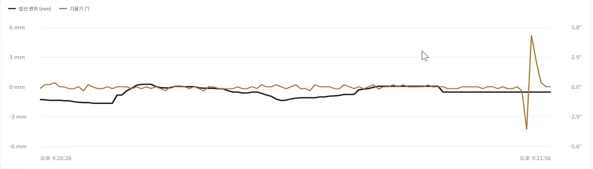

---

## 7. 최종본 이후에 더 해본 것 (R13.7 → R14)

시연본 말고 더 정확하게 만들어보려고 계속 붙잡았던 것들. 결과적으로 시연엔 안 들어갔다.

- CSV 55,512줄을 시간축으로 다시 맞춰봤다. 진동 → 기울기 → 반대로 기울기 → 약 100 mm 이동 순서.
  - 처음 −18° 기울였을 때 변위가 +4.9 mm로 같이 움직이고, 원래대로 돌아와도 +14.9 mm가 남았다
  - 반대로 기울였을 때 거리 잔차가 약 72 mm까지 커졌다
  - 실제 +100 mm인데 +68\~74 mm만 따라갔다
  - Tag 1 – Anchor 4 보정 편향이 약 +535 mm인 링크도 있었다 → 필터 문제가 아니라 좌표, 편향, NLOS, 기하 자체를 다시 봐야 했다
- 케이스 중심 ≠ 안테나 중심 (9월 17일)
  센서 좌표를 케이스 중심으로 잡고 있었는데 UWB 거리는 안테나 기준이었다. 케이스를 재보니 긴 축 +32.5 mm, 짧은 축 +5.0 mm, 바닥 → 안테나 21.0 mm, 표면 방향 −2.5 mm 차이가 났다.
  → 설치 가능한지는 케이스 외형으로, 거리 계산은 안테나 좌표로 나눴다 (R13.7.3 \~ R13.7.4)
- 실제 +70 mm 올렸는데 최대 48.8 mm만 나왔다 (R13.13). Anchor별로 쪼개보니

| Anchor | 예상 거리 변화 | 실제 거리 변화 | |
|:---:|:---:|:---:|:---:|
| A1 | +35.5 mm | +34.6 mm | 맞음 |
| A2 | +23.5 mm | −8.9 mm | 방향 반대 |
| A3 | −29.6 mm | −30.2 mm | 맞음 |
| A4 | −22.2 mm | +18.1 mm | 방향 반대 |

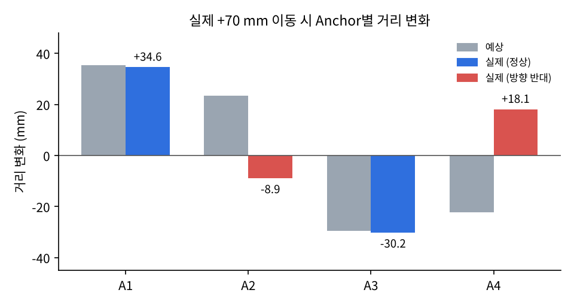

  - A1, A3만으로 다시 계산하면 65.7\~77.6 mm. UWB가 다 틀린 게 아니라 틀린 Anchor를 못 걸러내고 섞어 쓴 게 문제였다 (사후 계산)
- 그래서 R14는 방향을 바꿨다. 상태 판정 로직을 계속 덧붙이지 말고, 설치 기하(Tag · Anchor 좌표, 표면 방향, Anchor별 초기 거리)로 "측정 거리랑 제일 잘 맞는 변위가 뭐냐"부터 계산했다 (Geometry-First).
- 그래도 실물에선 계속 막혔다

| 버전 | 실제 | 결과 | 본 것 |
|:---:|:---:|:---:|:---:|
| R14.10 | +50 mm | +9.85 mm | 패킷 223/223 다 들어왔는데 220번 HOLD. 통신이 아니라 추정기가 새 값을 못 믿음 |
| R14.11 | +50 mm 유지 | RMSE 2.96 mm (78개) | 복귀 구간은 RMSE 8.48 mm |
| R14.14 | - | Anchor 2 성공률 58.1% | 처음 65초 무응답, 돌아온 뒤 NLOS 의심 310개 중 305개 |
| R14.16 | +25 mm | 중간 −68.17 mm, 최종 +7.37 mm | 333패킷 중 갱신 10번, Boot ID 6번 바뀜 → 전원이나 리셋 문제도 의심 |

- 여기서 얻은 것: 문제를 "통신 됨 → 거리 잼 → 기하 후보 정상 → 추정기가 받아줌 → 화면 갱신" 5단계로 나눠서 어디서 끊기는지 따로 봐야 했다. 그래서 Anchor별 원시 · 보정 거리, 품질, 잔차, IMU, 중간 추정값, HOLD 여부, 실험자가 입력한 실제 변위까지 한 시간축으로 다 기록하게 바꿨다 (231초에 96.2 MB 나온 적도 있음).

---

## 8. 대회장에서 생긴 일

- 실험실에선 잘 되던 Anchor 연결이 대회장에서 불안정해졌다. 사람이랑 전자기기 많은 곳이라 UWB 오차도 커지고 배터리도 평소보다 빨리 닳았다.
- Tag 기울기 · 진동은 계속 들어와서 Wi-Fi나 PC가 죽은 건 아니라고 보고 UWB 쪽을 먼저 의심했다.
- "사람 많아서 그렇다"로 끝내지 않으려고 전원 / SPI / DW3000 상태 / 안테나 · 가림 / 주변 전파로 나눠서 봤다.
- Anchor 펌웨어에 수신 감시(watchdog)를 넣었다. 수신 대기가 900 ms 동안 멈춰 있으면 다시 수신을 시작한다 (시연본).
- 이후 R14에서 더 키웠다. 응답 실패 반복이나 자기 Anchor로 오는 요청만 오래 끊기는 것 감지 → DW3000 재초기화 → 그래도 안 되면 ESP32를 재시작한다.
- 배터리는 아직 원인을 못 찾았다. 부품별 소비 전력부터 재보고 PCB 전원선을 손볼 생각이다.

---

## 9. 남은 것

- UWB가 mm\~cm 변위 재는 메인 센서로 맞는지부터 다시 생각해봤다. 실측에선 편향, NLOS, 반사 영향이 실제 변위보다 컸다.
- 대안으로 레이저/ToF, 카메라(DIC · 마커), 수준계(HLS), FMCW 레이더, RTK-GNSS, LVDT 같은 것도 비교해봤다.
- 통신은 Wi-Fi 대신 LoRa P2P(KR920)로 Tag가 알아서 측정하고 결과만 보내는 구조도 검토만 해뒀다.
- 지금은 개인 프로젝트로 DW3000 CIR 파형을 입력으로 딥러닝 모델이 거리 오차 자체를 보정하는 걸 연구하고 있다. 4장의 CIR 기반 NLOS 점수(가중치만 낮추고 거리는 안 건드림)와는 다른 접근이다.

---

## 저장소 구성

```text
firmware/tag/ESP_control{,2,3}/   TAG-01~03 (UWB initiator + ADXL345 + Wi-Fi UDP)
firmware/anchor/if_ANCHOR1~4/     ANCHOR-01~04 (UWB responder)
hardware/tag-pcb/                 Altium 센서 노드 PCB (회로도, PCB, 거버)
hardware/enclosure/               센서 케이스·브래킷 3D CAD (Inventor .ipt, STL)
web/                              Node.js 서버 + 웹 UI + 테스트(tools/), R13.5 변경 내역 · 시험 보고서(notes/)
docs/                             통신 프로토콜, UWB 오차 보정, R12 가이드, 이미지
```

코드는 ECE IF 시연 최종본(R13.5)이다.

### 실행

```bash
cd web
npm install
cp .env.example .env    # OPENAI_API_KEY는 선택 (없으면 규칙 기반 데모 모드)
npm start               # http://localhost:8080
```

센서 없이 보려면 `npm run mock:sensors`, 알고리즘 테스트는 `npm run test:tracking` 등을 쓴다.

펌웨어는 Arduino IDE (ESP32 보드 패키지)로 올린다. 태그 펌웨어의 `WIFI_SSID`, `WIFI_PASSWORD`, `SERVER_IP`는 환경에 맞게 바꿔야 하고, DW3000 Arduino 라이브러리(Makerfabs)는 따로 설치해야 한다.
